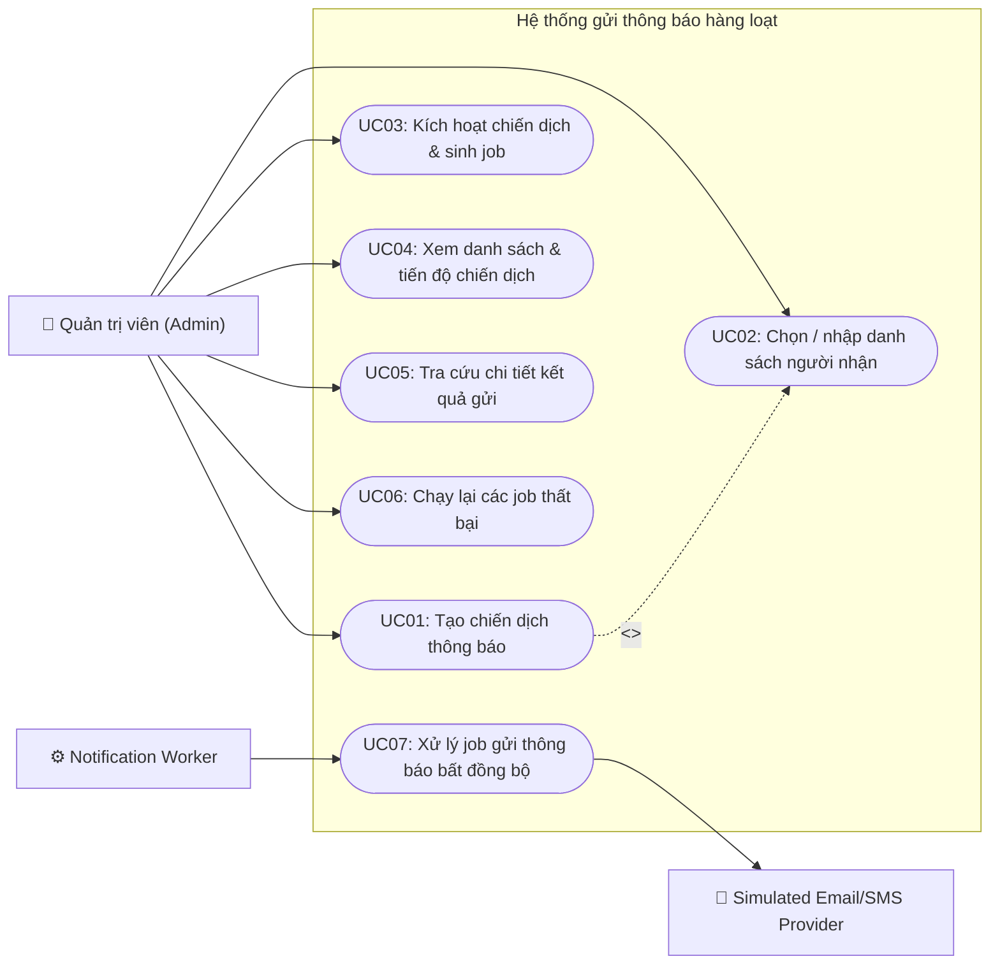

# 01. Phân tích yêu cầu & Đặc tả Use Case

> **Đề tài 11:** Hệ thống gửi thông báo hàng loạt (Mass Notification System)  
> **Học phần:** Phát triển ứng dụng phân tán

---

## 1. Đặt vấn đề & Mục tiêu bài toán

Trong thực tế, các hệ thống doanh nghiệp thường xuyên cần phát đi một lượng lớn thông báo cùng lúc cho hàng nghìn hoặc hàng chục nghìn người nhận (thông báo học vụ, khuyến mãi, cảnh báo bảo trì, nhắc lịch...). Nếu API xử lý tuần tự và gửi trực tiếp từng thông báo ngay trong luồng HTTP request:

- Thời gian phản hồi bị kéo dài, dễ gây **HTTP timeout** ở phía client.
- Không tận dụng được khả năng **mở rộng ngang (horizontal scaling)** với nhiều tiến trình xử lý song song.
- Khi dịch vụ gửi bên ngoài gặp sự cố tạm thời hoặc một tiến trình gặp lỗi, toàn bộ lô thông báo có nguy cơ bị gián đoạn và khó khôi phục chính xác những phần tử chưa gửi.

**Mục tiêu của hệ thống:**
1. **Tách biệt tiếp nhận và xử lý (Decoupling):** `Campaign API` chỉ tiếp nhận yêu cầu quản trị chiến dịch, lưu trữ bền vững và sinh các công việc gửi (*delivery jobs*) đẩy vào hàng đợi tin nhắn **RabbitMQ**.
2. **Xử lý bất đồng bộ & phân tán (Asynchronous & Distributed Processing):** Nhiều **Notification Worker** chạy độc lập cùng tiêu thụ job từ RabbitMQ để gửi thông báo song song (giả lập kênh Email/SMS) và ghi nhận kết quả về **PostgreSQL**.
3. **Quan sát & phục hồi lỗi (Observability & Fault Recovery):** Cho phép theo dõi tiến độ `Pending` / `Sent` / `Failed` theo thời gian thực, tra cứu lịch sử gửi chi tiết và kích hoạt gửi lại các thông báo thất bại một cách an toàn.

---

## 2. Phạm vi hệ thống (Scope)

### 2.1. Trong phạm vi (In Scope)
- Quản lý vòng đời chiến dịch thông báo (`Draft` → `Running` → `Completed`).
- Nhập danh sách người nhận trực tiếp hoặc nạp từ tệp CSV trên **Admin Console Client**.
- Sinh job gửi thông báo cho từng người nhận và truyền tải đáng tin cậy qua **RabbitMQ**.
- Xử lý song song bởi nhiều instance **Notification Worker** với cơ chế xác nhận thủ công (*manual acknowledgement*).
- Giả lập gửi Email/SMS có độ trễ và tỉ lệ lỗi cấu hình được qua biến môi trường để kiểm chứng khả năng chịu lỗi.
- Thống kê tiến độ gửi, tra cứu danh sách kết quả gửi (có phân trang, lọc theo trạng thái) và chạy lại các job thất bại.
- Đóng gói đầy đủ bằng Docker (`Dockerfile` riêng cho từng service + `docker-compose.yml`).
- Các cơ chế mở rộng phân tán: Transactional Outbox, Retry Queue + Dead-Letter Queue (DLQ), Idempotent Consumer, Correlation ID, Health Check, Structured Logging, xác thực API Key.

### 2.2. Ngoài phạm vi (Out of Scope)
- Tích hợp cổng thanh toán hoặc nhà cung cấp SMS/Email thương mại trả phí (AWS SES, Twilio...) — hệ thống sử dụng bộ gửi giả lập qua interface `INotificationSender` để dễ dàng thay thế khi cần.
- Giao diện quản trị người dùng cuối trên trình duyệt hoặc ứng dụng di động nhận push notification.
- Quản lý phân quyền đa vai trò phức tạp (RBAC nhiều cấp).

---

## 3. Xác định tác nhân (Actors)

| Mã | Tác nhân | Loại | Vai trò trong hệ thống |
|---|---|---|---|
| **ACT-01** | **Quản trị viên (Admin)** | Tác nhân chính (Con người) | Sử dụng `Admin.Client` (Console App) để tạo chiến dịch, nạp danh sách người nhận, kích hoạt gửi, theo dõi thống kê, tra cứu chi tiết và yêu cầu chạy lại các job lỗi. |
| **ACT-02** | **Notification Worker** | Tác nhân hệ thống (Tiến trình nền) | Nhận message job từ RabbitMQ, thực thi gửi thông báo độc lập, cập nhật trạng thái `Sent` / `Failed` và phản hồi `ack` / `nack` về broker. |
| **ACT-03** | **Dịch vụ gửi thông báo (Simulated Provider)** | Tác nhân ngoài (Giả lập) | Đại diện cho cổng gửi Email/SMS; trả về kết quả thành công hoặc ngoại lệ thất bại tạm thời/vĩnh viễn. |

---

## 4. Sơ đồ & Đặc tả Use Case

### 4.1. Sơ đồ tổng quan Use Case

### 4.2. Đặc tả chi tiết các Use Case chính

#### UC01 & UC02 – Tạo chiến dịch thông báo và nhập danh sách người nhận
- **Tác nhân:** Quản trị viên (`Admin`).
- **Tiền điều kiện:** `Campaign.Api` và `PostgreSQL` đang hoạt động.
- **Luồng sự kiện chính:**
  1. Admin chọn chức năng tạo chiến dịch trên `Admin.Client`.
  2. Admin nhập tên chiến dịch, kênh gửi (`Email` hoặc `Sms`), tiêu đề và nội dung thông báo.
  3. Admin nhập danh sách người nhận trực tiếp từ bàn phím hoặc cung cấp đường dẫn tệp `.csv`.
  4. `Admin.Client` kiểm tra sơ bộ định dạng tệp và gửi yêu cầu `POST /campaigns` tới `Campaign.Api`.
  5. `Campaign.Api` kiểm tra tính hợp lệ (nội dung không rỗng, danh sách người nhận ≥ 1, loại bỏ địa chỉ trùng lặp trong cùng chiến dịch), lưu `Campaign` ở trạng thái `Draft` cùng danh sách `Recipient` vào CSDL.
  6. API trả về mã `201 Created` kèm thông tin chiến dịch vừa tạo.
- **Luồng ngoại lệ:**
  - *4a. Dữ liệu không hợp lệ (thiếu tiêu đề/nội dung, danh sách người nhận trống, sai định dạng địa chỉ nhận):* API trả về `400 Bad Request` kèm chi tiết lỗi validation.

#### UC03 – Kích hoạt chiến dịch & sinh job gửi thông báo
- **Tác nhân:** Quản trị viên (`Admin`).
- **Tiền điều kiện:** Chiến dịch đã tồn tại và đang ở trạng thái `Draft`.
- **Luồng sự kiện chính:**
  1. Admin chọn chiến dịch cần chạy và gửi lệnh bắt đầu (`POST /campaigns/{id}/start`).
  2. `Campaign.Api` chuyển trạng thái chiến dịch sang `Running`, khởi tạo các bản ghi `Delivery` với trạng thái `Pending` cho từng người nhận.
  3. Trong cùng giao dịch CSDL, hệ thống ghi nhận sự kiện/outbox để đảm bảo không thất thoát job nếu RabbitMQ tạm thời gián đoạn.
  4. Bộ phát nền (*Outbox Dispatcher* / *Publisher*) đẩy từng message `NotificationJob` vào exchange của RabbitMQ với chế độ bền vững (`persistent`).
  5. API phản hồi ngay `202 Accepted` (hoặc `200 OK`) mà không chờ quá trình gửi hoàn tất.
- **Luồng ngoại lệ:**
  - *2a. Chiến dịch không tồn tại:* Trả về `404 Not Found`.
  - *2b. Chiến dịch đã ở trạng thái `Running` hoặc `Completed`:* Trả về `409 Conflict` để ngăn sinh trùng job.

#### UC04 – Xem danh sách & theo dõi tiến độ chiến dịch
- **Tác nhân:** Quản trị viên (`Admin`).
- **Luồng sự kiện chính:**
  1. Admin xem danh sách chiến dịch (`GET /campaigns`) hoặc xem chi tiết một chiến dịch (`GET /campaigns/{id}`).
  2. `Campaign.Api` truy vấn thông tin chiến dịch cùng bộ đếm tổng số thông báo theo từng trạng thái: `Pending`, `Sent`, `Failed`.
  3. `Admin.Client` hiển thị bảng tiến độ và có thể tự động làm mới định kỳ (*polling*) cho tới khi chiến dịch chuyển sang `Completed` (khi `Pending = 0`).

#### UC05 – Tra cứu chi tiết kết quả gửi
- **Tác nhân:** Quản trị viên (`Admin`).
- **Luồng sự kiện chính:**
  1. Admin yêu cầu xem danh sách kết quả gửi của một chiến dịch (`GET /campaigns/{id}/deliveries?status=...&page=...&pageSize=...`).
  2. `Campaign.Api` trả về danh sách phân trang từng `Delivery` gồm: thông tin người nhận, trạng thái hiện tại (`Pending`/`Sent`/`Failed`), số lần thử (`AttemptCount`), thời điểm xử lý gần nhất và thông báo lỗi (nếu có).

#### UC06 – Chạy lại các job thất bại
- **Tác nhân:** Quản trị viên (`Admin`).
- **Tiền điều kiện:** Chiến dịch có ít nhất một `Delivery` ở trạng thái `Failed`.
- **Luồng sự kiện chính:**
  1. Admin gửi yêu cầu chạy lại các thông báo lỗi (`POST /campaigns/{id}/retry-failed`).
  2. `Campaign.Api` lọc các bản ghi `Delivery` có trạng thái `Failed` của chiến dịch, đặt lại trạng thái về `Pending`, chuyển chiến dịch về `Running` (nếu đã `Completed`) và sinh message mới đưa vào RabbitMQ.
  3. Các Worker tiếp nhận và xử lý lại các job này như luồng bình thường.
- **Luồng ngoại lệ:**
  - *2a. Không có bản ghi `Failed` nào:* Trả về `200 OK` với số lượng job chạy lại bằng `0`.

#### UC07 – Xử lý job gửi thông báo bất đồng bộ tại Worker
- **Tác nhân:** `Notification Worker`, `Simulated Provider`.
- **Tiền điều kiện:** Hàng đợi RabbitMQ có message `NotificationJob`; ít nhất 1 instance `Notification.Worker` đang chạy.
- **Luồng sự kiện chính:**
  1. Worker nhận message từ queue theo giới hạn `PrefetchCount` cấu hình sẵn.
  2. Worker kiểm tra tính **idempotent**: nếu `Delivery` tương ứng trong CSDL đã có trạng thái `Sent` thì bỏ qua việc gửi lại và gửi `BasicAck` ngay.
  3. Worker gọi `INotificationSender` để thực hiện gửi thông báo tới địa chỉ người nhận, tăng `AttemptCount`.
  4. Nếu gửi thành công: cập nhật trạng thái `Sent`, ghi `SentAtUtc`, kiểm tra hoàn tất chiến dịch và gửi `BasicAck` cho RabbitMQ.
- **Luồng ngoại lệ:**
  - *4a. Gửi thất bại tạm thời và chưa vượt ngưỡng tự động thử lại:* Đẩy sang hàng đợi chờ thử lại (*Retry Queue* có TTL) hoặc ghi nhận lỗi lần thử.
  - *4b. Vượt quá số lần tự động thử lại tối đa:* Cập nhật bản ghi `Delivery` thành `Failed` kèm lý do lỗi (`LastError`), chuyển message sang *Dead-Letter Queue (DLQ)* (hoặc xác nhận hoàn tất xử lý lỗi) để chờ Admin quyết định chạy lại qua **UC06**.
  - *4c. Worker bị dừng đột ngột khi chưa `Ack`:* RabbitMQ tự động thu hồi message chưa xác nhận và phân phối cho một Worker khác đang hoạt động.

---

## 5. Yêu cầu chức năng (Functional Requirements)

Bảng ánh xạ đầy đủ 8 chức năng của đề bài sang yêu cầu hệ thống và API tương ứng:

| Mã YC | Chức năng theo đề bài | Mô tả chi tiết yêu cầu | Thành phần xử lý | API liên quan |
|---|---|---|---|---|
| **FR-01** | 1. Tạo chiến dịch thông báo | Lưu thông tin chiến dịch gồm tên, kênh gửi (`Email`/`Sms`), tiêu đề, nội dung, thời gian tạo, trạng thái khởi đầu `Draft`. | `Admin.Client`, `Campaign.Api` | `POST /campaigns` |
| **FR-02** | 2. Chọn hoặc nhập danh sách người nhận | Hỗ trợ nhập danh sách người nhận trực tiếp hoặc đọc từ file CSV khi tạo chiến dịch; kiểm tra định dạng và khử trùng lặp theo chiến dịch. | `Admin.Client`, `Campaign.Api` | `POST /campaigns` |
| **FR-03** | 3. Sinh các job gửi thông báo và đưa vào RabbitMQ | Chuyển từng người nhận thành một bản ghi `Delivery (Pending)` và phát message bền vững vào RabbitMQ mà không làm nghẽn API. | `Campaign.Api`, `RabbitMQ` | `POST /campaigns/{id}/start` |
| **FR-04** | 4. Nhiều Worker nhận và xử lý job độc lập | Hỗ trợ chạy đồng thời nhiều container `Notification.Worker` cùng đọc một queue (*Competing Consumers*), chia tải tự động qua `BasicQos`. | `RabbitMQ`, `Notification.Worker` | – *(giao tiếp AMQP)* |
| **FR-05** | 5. Ghi nhận kết quả thành công / thất bại | Cập nhật chính xác trạng thái `Sent` hoặc `Failed`, thời điểm gửi, số lần thử và nguyên nhân thất bại của từng thông báo vào PostgreSQL. | `Notification.Worker` | – |
| **FR-06** | 6. Theo dõi số lượng `Pending`, `Sent`, `Failed` | Thống kê tổng số lượng người nhận và số lượng theo từng trạng thái `Pending`, `Sent`, `Failed` của mỗi chiến dịch. | `Campaign.Api`, `Admin.Client` | `GET /campaigns`, `GET /campaigns/{id}` |
| **FR-07** | 7. Tra cứu chi tiết kết quả gửi | Liệt kê danh sách từng bản ghi `Delivery` của chiến dịch, hỗ trợ phân trang (`page`, `pageSize`) và lọc theo trạng thái (`status`). | `Campaign.Api`, `Admin.Client` | `GET /campaigns/{id}/deliveries` |
| **FR-08** | 8. Chạy lại các job thất bại | Cho phép kích hoạt gửi lại các `Delivery` đang ở trạng thái `Failed` theo cơ chế an toàn, có giới hạn và kiểm soát trạng thái. | `Admin.Client`, `Campaign.Api`, `Notification.Worker` | `POST /campaigns/{id}/retry-failed` |

---

## 6. Yêu cầu phi chức năng & đặc tính phân tán (Non-Functional Requirements)

| Mã YC | Nhóm yêu cầu | Nội dung yêu cầu & cách đáp ứng |
|---|---|---|
| **NFR-01** | **Nền tảng kỹ thuật** | Phát triển bằng **C# trên .NET 10**; dịch vụ API xây dựng theo mô hình **ASP.NET Core Minimal API**; client dạng **Console App**. |
| **NFR-02** | **Độc lập dịch vụ & Đóng gói** | `Campaign.Api`, `Notification.Worker`, `Admin.Client` tách thành các project độc lập, mỗi service có `Dockerfile` multi-stage riêng; toàn hệ thống khởi chạy qua `docker-compose.yml` và giao tiếp bằng **Docker network + service name**. |
| **NFR-03** | **Tách biệt cấu hình môi trường** | Không hard-code chuỗi kết nối PostgreSQL, host/port/user RabbitMQ, URL API hay tỉ lệ lỗi giả lập trong mã nguồn; toàn bộ được nạp qua `IConfiguration` / biến môi trường (`.env` / `docker-compose`). |
| **NFR-04** | **Độ tin cậy truyền tin (Reliability)** | Sử dụng **durable exchange/queue**, **persistent message** (`DeliveryMode = 2`), **publisher confirms** ở phía gửi và **manual ack** ở phía nhận để không mất job khi broker hoặc worker khởi động lại. |
| **NFR-05** | **Khả năng chịu lỗi & Tự phục hồi (Fault Tolerance)** | Khi RabbitMQ hoặc PostgreSQL tạm thời dừng hoạt động, API và Worker có cơ chế tự thử kết nối lại (*exponential backoff* / *auto-recovery*); khi một Worker dừng đột ngột, các Worker còn lại tiếp tục xử lý phần việc còn dở. |
| **NFR-06** | **Khả năng mở rộng ngang (Scalability)** | Có thể tăng/giảm số lượng `Notification.Worker` (`docker compose up --scale notification-worker=3`) mà không cần sửa code hay cấu hình lại API. |
| **NFR-07** | **Khả năng quan sát (Logging)** | Ghi log đầy đủ tại các mốc quan trọng: tạo chiến dịch, sinh job, publish message, worker nhận job, gửi thành công/thất bại, retry. |
| **NFR-08** | **Hiệu năng phản hồi API** | Các endpoint REST phản hồi nhanh, không thực hiện gửi thông báo đồng bộ trong luồng HTTP request. |

---

## 7. Yêu cầu mở rộng dự kiến thực hiện (Extended Requirements)

Sau khi hoàn thiện toàn bộ các yêu cầu bắt buộc ở mục 5 và 6, hệ thống sẽ bổ sung các cơ chế nâng cao theo hướng dẫn của học phần:

1. **EXT-01 – Retry Queue & Dead-Letter Queue (DLQ):** Tự động thử lại có độ trễ đối với lỗi tạm thời trước khi đánh dấu `Failed` và đẩy vào DLQ.
2. **EXT-02 – Idempotent Consumer:** Đảm bảo một thông báo không bị gửi lặp cho người nhận ngay cả khi RabbitMQ phát lại message (*at-least-once delivery*).
3. **EXT-03 – Correlation ID:** Sinh và truyền mã vết `X-Correlation-Id` xuyên suốt từ `Admin.Client` → `Campaign.Api` → header của message RabbitMQ → `Notification.Worker`.
4. **EXT-04 – Health Check:** Cung cấp endpoint `/health/live` và `/health/ready` kiểm tra kết nối thực tế tới PostgreSQL và RabbitMQ, tích hợp vào `healthcheck` của Docker Compose.
5. **EXT-05 – Structured Logging:** Chuẩn hóa log có cấu trúc (Serilog) kèm `CampaignId`, `DeliveryId`, `WorkerId`, `CorrelationId`.
6. **EXT-06 – Xác thực API Key:** Bảo vệ các endpoint quản trị chiến dịch trên `Campaign.Api` bằng header `X-Api-Key` cấu hình qua biến môi trường.

---

## 8. Giả định & Ràng buộc (Assumptions & Constraints)

- Mỗi bản ghi `Delivery` tương ứng với **1 người nhận trong 1 chiến dịch** (ràng buộc duy nhất theo cặp `(CampaignId, RecipientId)`), giúp kiểm soát chính xác trạng thái gửi và tính idempotent.
- Kênh gửi thông báo được trừu tượng hóa qua interface `INotificationSender`, mặc định sử dụng bộ giả lập có độ trễ ngẫu nhiên (ví dụ `50–300ms`) và tỉ lệ lỗi cấu hình được (ví dụ `15%`) để phục vụ minh họa trực quan kịch bản lỗi & chạy lại khi bảo vệ đồ án.
