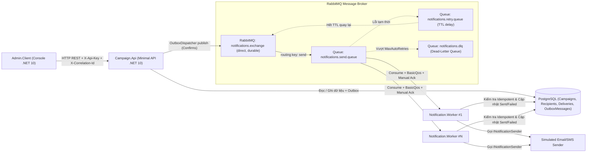
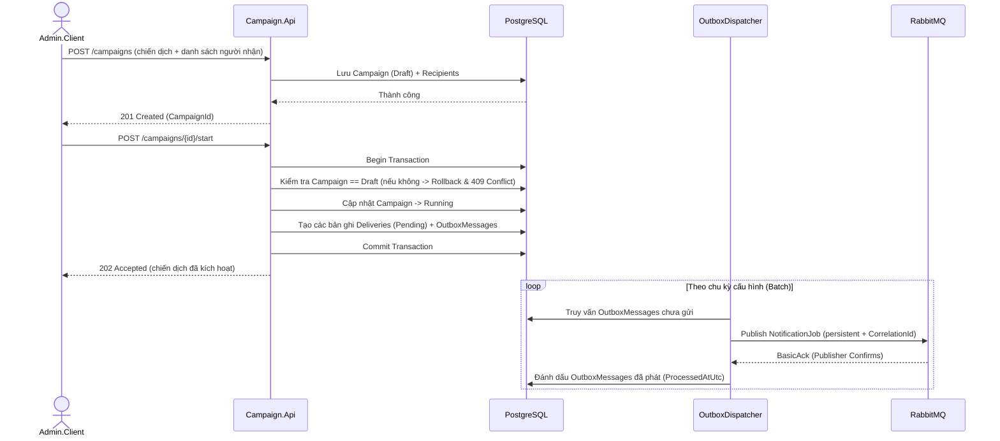
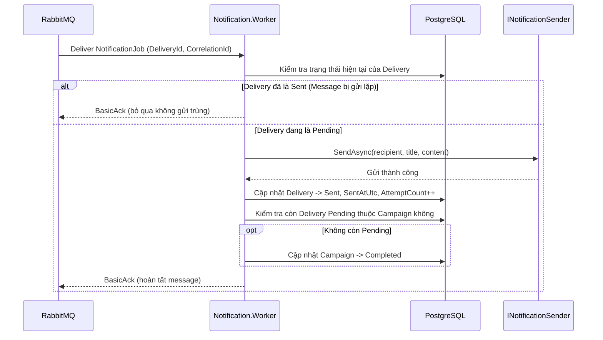
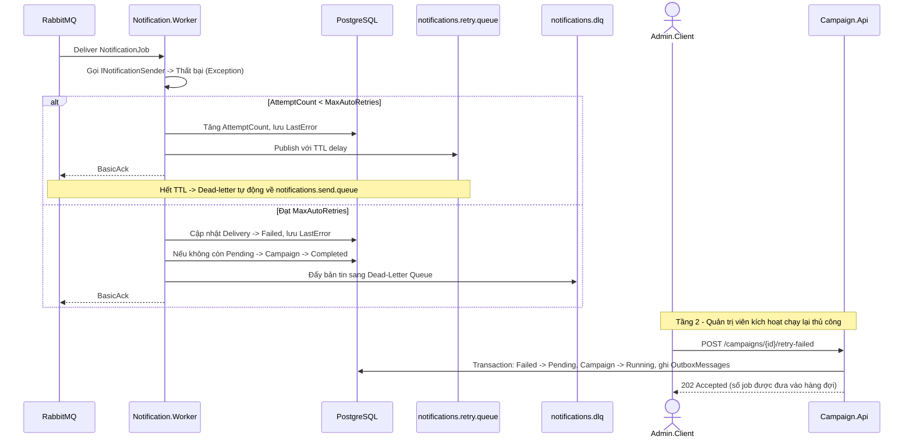
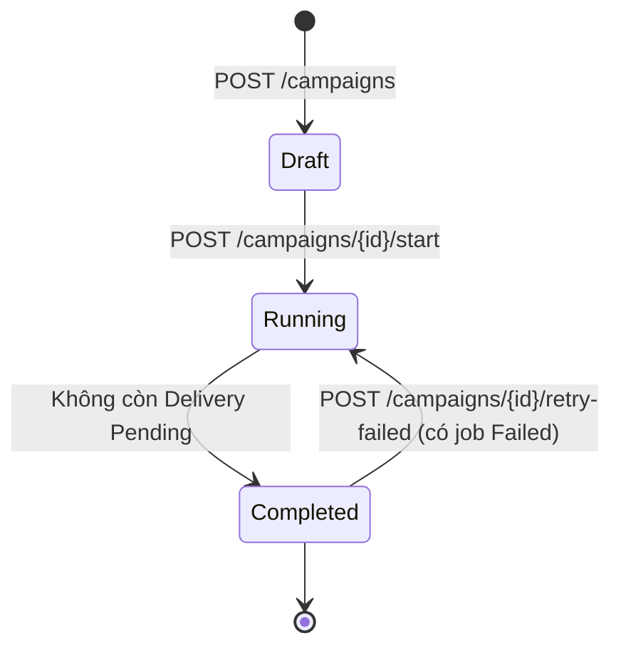
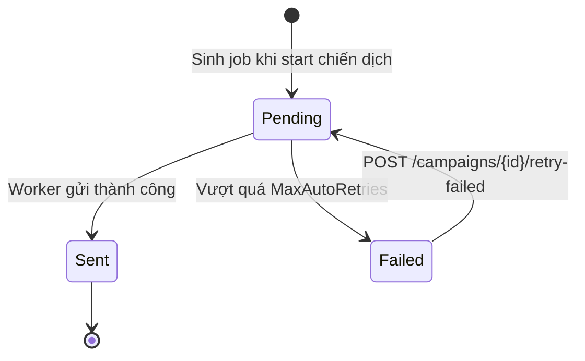
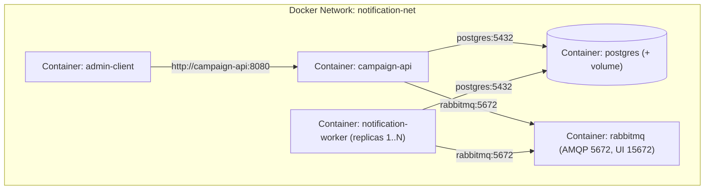

# 02. Thiết kế kiến trúc hệ thống

> **Đề tài 11:** Hệ thống gửi thông báo hàng loạt (Mass Notification System)  
> **Học phần:** Phát triển ứng dụng phân tán

---

## 1. Tổng quan kiến trúc & Nguyên lý thiết kế

Hệ thống được thiết kế theo mô hình **Producer – Message Broker – Competing Consumers** trên nền tảng **.NET 10**, tách biệt hoàn toàn giữa dịch vụ tiếp nhận yêu cầu (`Campaign.Api`), tầng điều phối thông điệp bất đồng bộ (`RabbitMQ`), cụm tiến trình xử lý song song (`Notification.Worker`) và cơ sở dữ liệu dùng chung (`PostgreSQL`).

Các nguyên lý thiết kế cốt lõi:
- **Bất đồng bộ & Tách ghép lỏng (Asynchronous Decoupling):** API chỉ lưu chiến dịch, sinh bản ghi công việc (`Delivery`) và đưa yêu cầu vào hàng đợi rồi phản hồi ngay (`202 Accepted`), không chờ gửi xong hàng loạt mới trả về cho client.
- **Nhất quán tin cậy (Transactional Outbox):** Việc tạo job trong PostgreSQL và ghi nhận sự kiện phát đi nằm trong cùng một transaction để tránh mất dữ liệu khi `RabbitMQ` tạm gián đoạn.
- **Mở rộng ngang (Horizontal Scalability):** Nhiều instance `Notification.Worker` đọc chung một hàng đợi với cơ chế phân phối công bằng (`BasicQos`) và xác nhận thủ công (`Manual Ack`), giúp tăng thông lượng xử lý mà không cần sửa cấu hình API.
- **Độc lập triển khai (Containerized Services):** Mỗi thành phần chạy trong một container riêng, kết nối qua mạng nội bộ Docker bằng tên dịch vụ (*service name*) và nhận toàn bộ tham số qua biến môi trường.

### Sơ đồ kiến trúc tổng thể



---

## 2. Phân rã thành phần & Cấu trúc Solution (.NET 10)

Mã nguồn hệ thống dự kiến được tổ chức thành một `.NET Solution` gồm 4 project trong `src/` và 1 project kiểm thử trong `tests/`:

```text
src/
├── Shared.Contracts/        # DTO, NotificationJobMessage, enum trạng thái, hằng số RabbitMQ & header
├── Campaign.Api/            # ASP.NET Core Minimal API, EF Core DbContext, Migrations, OutboxDispatcher
├── Notification.Worker/     # BackgroundService consumer, Idempotency check, INotificationSender
└── Admin.Client/            # Console App quản trị chiến dịch, nhập CSV, theo dõi & retry-failed
tests/
└── MassNotification.UnitTests/  # Unit test xUnit cho logic nghiệp vụ & máy trạng thái
```

| Thành phần | Vai trò chính | Trách nhiệm kỹ thuật |
|---|---|---|
| **`Shared.Contracts`** | Thư viện dùng chung | Định nghĩa hợp đồng dữ liệu trao đổi qua REST và AMQP (`NotificationJobMessage`), các enum (`CampaignStatus`, `DeliveryStatus`, `NotificationChannel`), tên exchange/queue và header chuẩn (`X-Correlation-Id`, `X-Api-Key`). |
| **`Campaign.Api`** | Dịch vụ tiếp nhận & điều phối | Cung cấp Minimal API (`POST /campaigns`, `GET /campaigns`, `GET /campaigns/{id}`, `POST /campaigns/{id}/start`, `GET /campaigns/{id}/deliveries`, `POST /campaigns/{id}/retry-failed`, `/health/live`, `/health/ready`); quản lý `NotificationDbContext`, chạy migration tự động, vận hành `OutboxDispatcherService` và RabbitMQ Publisher có bật *Publisher Confirms*. |
| **`Notification.Worker`** | Dịch vụ xử lý nền phân tán | Chạy `BackgroundService` tiêu thụ job từ `notifications.send.queue`, kiểm tra tính *idempotent*, gọi `INotificationSender` (`SimulatedEmailSender` / `SimulatedSmsSender`), cập nhật trạng thái `Delivery` và tự động hoàn tất chiến dịch trong PostgreSQL. |
| **`Admin.Client`** | Ứng dụng điều khiển phía quản trị | Console App giao tiếp với `Campaign.Api` qua `HttpClient`; hỗ trợ tạo chiến dịch, nhập danh sách người nhận trực tiếp hoặc từ tệp CSV, tự động làm mới tiến độ (`polling`), xem chi tiết kết quả gửi và kích hoạt chạy lại job lỗi. |
| **`MassNotification.UnitTests`** | Kiểm thử tự động | Kiểm thử đơn vị bằng xUnit cho quy tắc chuyển trạng thái chiến dịch, logic sinh job, xử lý idempotent và điều phối retry tại Worker. |

---

## 3. Luồng xử lý chi tiết

### 3.1. Tạo & Kích hoạt chiến dịch với Transactional Outbox

Mẫu **Transactional Outbox** giải quyết bài toán *dual-write*: nếu API ghi PostgreSQL thành công rồi mới gọi RabbitMQ trực tiếp nhưng lúc đó RabbitMQ sập hoặc mất mạng, job sẽ bị "mồ côi" ở trạng thái `Pending` mãi mãi. Bằng cách lưu cả `Delivery` và `OutboxMessage` trong **cùng một transaction CSDL**, hệ thống đảm bảo dữ liệu không bao giờ lệch pha.



### 3.2. Xử lý song song tại Notification Workers (Competing Consumers)

Nhiều instance `Notification.Worker` cùng lắng nghe trên một hàng đợi `notifications.send.queue`. RabbitMQ phân phối từng message tới Worker còn trống năng lực theo giới hạn `PrefetchCount` (`BasicQos`), bảo đảm một job tại một thời điểm chỉ do một Worker xử lý.



### 3.3. Cơ chế xử lý thất bại 2 tầng (Auto Retry + DLQ & Manual Retry)

Hệ thống phân tách rõ hai tầng xử lý lỗi để vừa tự khắc phục các lỗi mạng/cổng gửi nhất thời, vừa đáp ứng đúng yêu cầu cho phép quản trị viên chủ động chạy lại các job thất bại:

- **Tầng 1 – Tự động thử lại có độ trễ (Auto Retry + Dead-Letter Queue):** Khi `INotificationSender` gặp lỗi và `AttemptCount < MaxAutoRetries`, Worker cập nhật số lần thử + lý do lỗi rồi chuyển message sang `notifications.retry.queue` (gắn TTL chờ) và `BasicAck` message gốc. Khi hết thời gian TTL, RabbitMQ tự định tuyến lại message về `notifications.exchange` để đưa vào `notifications.send.queue`. Nếu đã đạt `MaxAutoRetries` mà vẫn thất bại, Worker đánh dấu `Delivery` thành `Failed`, ghi `LastError` và đẩy bản tin vào `notifications.dlq` để lưu vết phân tích.
- **Tầng 2 – Chạy lại thủ công bởi quản trị viên (Manual Retry):** Khi nhận được thông báo lỗi từ `GET /campaigns/{id}/deliveries`, Admin gọi `POST /campaigns/{id}/retry-failed`. `Campaign.Api` chuyển toàn bộ `Delivery` có trạng thái `Failed` của chiến dịch về `Pending`, chuyển trạng thái `Campaign` về `Running` (nếu trước đó đã `Completed`) và ghi `OutboxMessages` mới trong cùng một transaction để phát lại vào luồng xử lý.



---

## 4. Máy trạng thái (State Machines)

### 4.1. Vòng đời Chiến dịch (`Campaign`)



- Lệnh `POST /campaigns/{id}/start` chỉ hợp lệ khi chiến dịch ở trạng thái `Draft`; nếu chiến dịch đang `Running` hoặc đã `Completed`, API trả về `409 Conflict`.

### 4.2. Vòng đời Job gửi thông báo (`Delivery`)



---

## 5. Kiến trúc triển khai Docker & Tách biệt cấu hình môi trường

Toàn bộ hệ thống được đóng gói bằng Docker và điều phối qua một tệp `docker-compose.yml` duy nhất. Mọi container nằm trong cùng mạng bridge nội bộ (`notification-net`) và giao tiếp qua **Docker service name** thay vì địa chỉ IP hay `localhost`.



### Danh mục cấu hình môi trường chính

Mọi tham số phụ thuộc môi trường được tách khỏi mã nguồn thông qua tệp `.env` và biến môi trường của container:

| Biến môi trường | Dịch vụ sử dụng | Mục đích cấu hình |
|---|---|---|
| `ConnectionStrings__Postgres` | `Campaign.Api`, `Notification.Worker` | Chuỗi kết nối tới PostgreSQL qua service name `postgres`. |
| `RabbitMq__HostName`, `RabbitMq__Port`, `RabbitMq__UserName`, `RabbitMq__Password` | `Campaign.Api`, `Notification.Worker` | Thông tin kết nối broker RabbitMQ qua service name `rabbitmq`. |
| `Worker__PrefetchCount` | `Notification.Worker` | Số lượng job tối đa mỗi Worker nhận trước khi chờ `BasicAck` (chia tải đều). |
| `Worker__SimulatedFailureRate` | `Notification.Worker` | Tỉ lệ lỗi giả lập (ví dụ `0.15`) để kiểm thử luồng Retry / DLQ / `retry-failed`. |
| `Worker__MaxAutoRetries` | `Notification.Worker` | Số lần thử lại tự động tối đa trước khi đánh dấu `Failed` và chuyển sang DLQ. |
| `Auth__ApiKey` | `Campaign.Api`, `Admin.Client` | Khóa xác thực cho header `X-Api-Key` bảo vệ các endpoint quản trị. |
| `ApiClient__BaseUrl` | `Admin.Client` | URL gốc của API (mặc định `http://campaign-api:8080` trong Docker hoặc cấu hình ngoài khi chạy local). |

---

## 6. Cơ chế chịu lỗi, Phục hồi & Quan sát hệ thống

### 6.1. Ma trận xử lý sự cố phân tán

| Kịch bản sự cố | Hậu quả tiềm ẩn nếu không xử lý | Cơ chế xử lý & tự phục hồi của hệ thống |
|---|---|---|
| **1 Worker bị tắt đột ngột khi đang gửi** | Job bị kẹt ở trạng thái đang xử lý hoặc biến mất khỏi hàng đợi. | RabbitMQ phát hiện kênh AMQP bị ngắt khi chưa nhận `BasicAck`, tự động hoàn trả message về `notifications.send.queue` và phân phối lại cho Worker khác đang chạy. |
| **RabbitMQ tạm thời dừng hoạt động** | Lệnh `start` chiến dịch bị lỗi 500 và mất job; Worker mất kết nối tiêu thụ. | `Campaign.Api` vẫn lưu chiến dịch + `OutboxMessages` vào PostgreSQL và trả `202 Accepted`; khi RabbitMQ khởi động lại, `OutboxDispatcher` tiếp tục phát bù các message chưa gửi, còn Worker tự động kết nối lại (*auto-recovery* + backoff). |
| **PostgreSQL tạm thời gián đoạn** | Worker ném ngoại lệ khi cập nhật kết quả và mất message nếu lỡ `Ack`. | Áp dụng Polly retry cho thao tác DB; nếu vẫn không ghi được kết quả, Worker không gửi `BasicAck` bừa (từ chối/chờ phục hồi) để tránh mất trạng thái job. |
| **Client gọi trùng `POST /campaigns/{id}/start`** | Sinh trùng lặp bản ghi `Delivery` và gửi thông báo nhiều lần cho cùng người nhận. | Kiểm tra và cập nhật trạng thái `Draft -> Running` trong giao dịch CSDL; nếu chiến dịch không ở trạng thái `Draft`, API từ chối bằng mã `409 Conflict`. |
| **Message bị phát lặp (*at-least-once*)** | Người nhận nhận thông báo giống nhau nhiều lần. | **Idempotent Consumer:** Worker kiểm tra trạng thái `Delivery` trong PostgreSQL trước khi gọi `INotificationSender`; nếu đã là `Sent` thì bỏ qua và `BasicAck` ngay. |

### 6.2. Truy vết phân tán & Kiểm tra sức khỏe (Observability)

- **Correlation ID (`X-Correlation-Id`):** `Admin.Client` (hoặc middleware của `Campaign.Api` nếu client không gửi sẵn) tạo mã `CorrelationId`, gắn vào HTTP response, đính kèm trong bản ghi `OutboxMessages` và header của message RabbitMQ. Khi `Notification.Worker` nhận message, mã này được đưa vào ngữ cảnh log (`LogContext`) của **Serilog** để truy vết toàn bộ vòng đời một chiến dịch/job từ lúc gọi API tới lúc gửi xong.
- **Health Checks:**
  - `GET /health/live`: Kiểm tra tiến trình ứng dụng còn phản hồi.
  - `GET /health/ready`: Kiểm tra kết nối thực tế tới PostgreSQL và RabbitMQ; được dùng trực tiếp trong chỉ thị `healthcheck` và `depends_on` của `docker-compose.yml` để bảo đảm thứ tự khởi động an toàn.

---

## 7. Bước thiết kế tiếp theo

Thiết kế chi tiết lược đồ cơ sở dữ liệu (ERD các bảng `Campaigns`, `Recipients`, `Deliveries`, `OutboxMessages`, khóa ngoại, chỉ mục) và cấu trúc payload JSON của message `NotificationJob` sẽ được đặc tả trong tài liệu tiếp theo: `docs/03-thiet-ke-csdl-va-message.md`.
