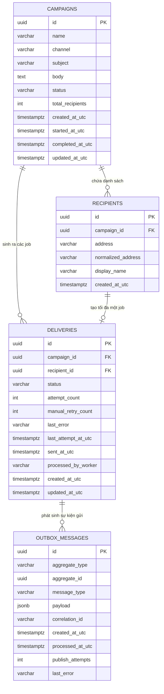

# 03. Thiết kế CSDL & Hợp đồng bản tin (`NotificationJob`)

> **Đề tài 11:** Hệ thống gửi thông báo hàng loạt (Mass Notification System)  
> **Học phần:** Phát triển ứng dụng phân tán

---

## 1. Tổng quan lưu trữ & Quy ước thiết kế CSDL

Hệ thống sử dụng **PostgreSQL** kết hợp **Entity Framework Core (Npgsql)** làm kho lưu trữ trạng thái chung cho `Campaign.Api` và các `Notification.Worker`. Các quy ước thiết kế thống nhất gồm:

- **Đặt tên `snake_case`:** Toàn bộ tên bảng, tên cột và tên chỉ mục/ràng buộc dùng chữ thường phân tách bằng dấu gạch dưới để tương thích tự nhiên với PostgreSQL.
- **Khóa chính `uuid` (`Guid.CreateVersion7()` trên .NET 10):** UUID v7 mang thành phần thời gian tăng dần ở các bit đầu, vừa bảo đảm tính duy nhất toàn cục giữa nhiều dịch vụ, vừa tránh phân mảnh B-Tree index khi ghi hàng loạt bản ghi `deliveries` và `outbox_messages`.
- **Thời gian chuẩn UTC (`timestamptz`):** Mọi mốc thời gian đều lưu theo UTC (`DateTimeOffset` trong C#, kiểu `timestamptz` trong PostgreSQL) với hậu tố `_at_utc`.
- **Enum lưu dạng chuỗi (`varchar`):** Các trạng thái (`Draft`, `Running`, `Completed`, `Pending`, `Sent`, `Failed`) và kênh (`Email`, `Sms`) được lưu dưới dạng chuỗi có ràng buộc kiểm tra, giúp dễ đọc trực tiếp trong DB và tránh sai lệch giá trị số khi bổ sung giá trị mới.

---

## 2. Sơ đồ thực thể liên kết (ERD)



---

## 3. Đặc tả chi tiết các bảng dữ liệu, Ràng buộc & Chỉ mục

### 3.1. Bảng `campaigns`
Lưu thông tin khai báo, nội dung thông báo và trạng thái vòng đời của từng chiến dịch.

| Cột | Kiểu dữ liệu | Ràng buộc | Mô tả |
|---|---|---|---|
| `id` | `uuid` | `PRIMARY KEY` | Mã định danh chiến dịch (`UUID v7`). |
| `name` | `varchar(200)` | `NOT NULL` | Tên chiến dịch do quản trị viên đặt. |
| `channel` | `varchar(20)` | `NOT NULL` | Kênh gửi (`Email` hoặc `Sms`). |
| `subject` | `varchar(250)` | `NULL` | Tiêu đề thông báo (bắt buộc với Email, tùy chọn với SMS). |
| `body` | `text` | `NOT NULL` | Nội dung thông báo sẽ gửi tới người nhận. |
| `status` | `varchar(20)` | `NOT NULL`, default `'Draft'` | Trạng thái chiến dịch (`Draft` / `Running` / `Completed`). |
| `total_recipients` | `int` | `NOT NULL`, default `0` | Tổng số người nhận hợp lệ thuộc chiến dịch. |
| `created_at_utc` | `timestamptz` | `NOT NULL` | Thời điểm tạo chiến dịch. |
| `started_at_utc` | `timestamptz` | `NULL` | Thời điểm gọi `POST /campaigns/{id}/start` thành công. |
| `completed_at_utc` | `timestamptz` | `NULL` | Thời điểm toàn bộ job không còn `Pending`. |
| `updated_at_utc` | `timestamptz` | `NOT NULL` | Thời điểm cập nhật bản ghi gần nhất. |

### 3.2. Bảng `recipients`
Lưu danh sách người nhận gắn với một chiến dịch cụ thể (nhập tay hoặc nạp từ CSV).

| Cột | Kiểu dữ liệu | Ràng buộc | Mô tả |
|---|---|---|---|
| `id` | `uuid` | `PRIMARY KEY` | Mã định danh người nhận. |
| `campaign_id` | `uuid` | `NOT NULL`, `FK -> campaigns(id) ON DELETE CASCADE` | Chiến dịch sở hữu người nhận này. |
| `address` | `varchar(320)` | `NOT NULL` | Địa chỉ nhận gốc (email hoặc số điện thoại). |
| `normalized_address` | `varchar(320)` | `NOT NULL` | Địa chỉ đã chuẩn hóa (trim, lowercase email) để chống trùng. |
| `display_name` | `varchar(150)` | `NULL` | Tên hiển thị người nhận (nếu có). |
| `created_at_utc` | `timestamptz` | `NOT NULL` | Thời điểm thêm bản ghi. |

- **Ràng buộc duy nhất:** `ux_recipients_campaign_address UNIQUE (campaign_id, normalized_address)` bảo đảm một địa chỉ không bị thêm lặp trong cùng chiến dịch.

### 3.3. Bảng `deliveries`
Đại diện cho từng job gửi thông báo cụ thể tới một người nhận, lưu trạng thái và kết quả xử lý của Worker.

| Cột | Kiểu dữ liệu | Ràng buộc | Mô tả |
|---|---|---|---|
| `id` | `uuid` | `PRIMARY KEY` | Mã định danh job gửi thông báo (`DeliveryId`). |
| `campaign_id` | `uuid` | `NOT NULL`, `FK -> campaigns(id) ON DELETE CASCADE` | Tham chiếu chiến dịch. |
| `recipient_id` | `uuid` | `NOT NULL`, `FK -> recipients(id) ON DELETE CASCADE` | Tham chiếu người nhận. |
| `status` | `varchar(20)` | `NOT NULL`, default `'Pending'` | Trạng thái job (`Pending` / `Sent` / `Failed`). |
| `attempt_count` | `int` | `NOT NULL`, default `0` | Tổng số lần Worker đã thực thi gửi (tăng qua từng lần thử). |
| `manual_retry_count` | `int` | `NOT NULL`, default `0` | Số lượt được quản trị viên chạy lại qua `retry-failed`. |
| `last_error` | `varchar(1000)` | `NULL` | Lý do thất bại gần nhất (xóa về `NULL` nếu gửi lại thành công). |
| `last_attempt_at_utc` | `timestamptz` | `NULL` | Thời điểm Worker thử gửi gần nhất. |
| `sent_at_utc` | `timestamptz` | `NULL` | Thời điểm gửi thành công (`Status = Sent`). |
| `processed_by_worker` | `varchar(100)` | `NULL` | Tên/ID container Worker xử lý (dùng kiểm chứng chia tải nhiều Worker). |
| `created_at_utc` | `timestamptz` | `NOT NULL` | Thời điểm sinh job. |
| `updated_at_utc` | `timestamptz` | `NOT NULL` | Thời điểm cập nhật trạng thái gần nhất. |

- **Ràng buộc duy nhất:** `ux_deliveries_campaign_recipient UNIQUE (campaign_id, recipient_id)` bảo đảm mỗi người nhận trong một chiến dịch chỉ có duy nhất một bản ghi `Delivery`, ngăn sinh job trùng khi gọi API đồng thời.

### 3.4. Bảng `outbox_messages`
Lưu hàng đợi sự kiện xuất bản theo mẫu **Transactional Outbox**, ghi chung transaction với bảng `campaigns` và `deliveries` khi kích hoạt hoặc chạy lại chiến dịch.

| Cột | Kiểu dữ liệu | Ràng buộc | Mô tả |
|---|---|---|---|
| `id` | `uuid` | `PRIMARY KEY` | Mã bản ghi outbox (đồng thời có thể dùng làm `MessageId`). |
| `aggregate_type` | `varchar(50)` | `NOT NULL` | Loại thực thể gốc (ví dụ `'Delivery'`). |
| `aggregate_id` | `uuid` | `NOT NULL` | `DeliveryId` liên kết với bản tin. |
| `message_type` | `varchar(100)` | `NOT NULL` | Tên contract bản tin (ví dụ `'NotificationJobMessage'`). |
| `payload` | `jsonb` | `NOT NULL` | Nội dung JSON đầy đủ của `NotificationJobMessage`. |
| `correlation_id` | `varchar(64)` | `NOT NULL` | Mã truy vết từ HTTP request tạo ra job. |
| `created_at_utc` | `timestamptz` | `NOT NULL` | Thời điểm đưa vào outbox. |
| `processed_at_utc` | `timestamptz` | `NULL` | Thời điểm `OutboxDispatcher` phát xong và nhận confirm từ RabbitMQ. |
| `publish_attempts` | `int` | `NOT NULL`, default `0` | Số lần thử publish sang RabbitMQ. |
| `last_error` | `varchar(1000)` | `NULL` | Lỗi publish gần nhất nếu RabbitMQ gián đoạn. |

### 3.5. Tổng hợp Chỉ mục (Indexes)

| Tên chỉ mục | Bảng | Cột & Điều kiện | Mục đích truy vấn |
|---|---|---|---|
| `ux_recipients_campaign_address` | `recipients` | `(campaign_id, normalized_address)` `UNIQUE` | Chống trùng người nhận trong cùng chiến dịch. |
| `ux_deliveries_campaign_recipient` | `deliveries` | `(campaign_id, recipient_id)` `UNIQUE` | Bảo đảm 1 người nhận / 1 job trong chiến dịch. |
| `ix_campaigns_status_created` | `campaigns` | `(status, created_at_utc DESC)` | Phục vụ `GET /campaigns` lọc trạng thái & phân trang mới nhất. |
| `ix_deliveries_campaign_status` | `deliveries` | `(campaign_id, status)` | Đếm `Pending`/`Sent`/`Failed`, lọc `GET /campaigns/{id}/deliveries`, kiểm tra hoàn tất chiến dịch và tìm job `Failed` khi `retry-failed`. |
| `ix_outbox_unprocessed` | `outbox_messages` | `(created_at_utc)` `WHERE processed_at_utc IS NULL` | Partial index giúp `OutboxDispatcher` quét nhanh các bản tin chưa phát, bỏ qua dữ liệu đã xử lý. |

---

## 4. Đặc tả Enum & Quy tắc đồng thời an toàn

### 4.1. Danh sách Enum trong `Shared.Contracts`

| Enum | Giá trị | Ý nghĩa |
|---|---|---|
| `NotificationChannel` | `Email`, `Sms` | Kênh gửi thông báo của chiến dịch. |
| `CampaignStatus` | `Draft`, `Running`, `Completed` | Trạng thái vòng đời chiến dịch. |
| `DeliveryStatus` | `Pending`, `Sent`, `Failed` | Trạng thái xử lý của từng job gửi thông báo. |

### 4.2. Quy tắc cập nhật nguyên tử (Concurrency & Idempotency)

Do nhiều `Notification.Worker` chạy song song và RabbitMQ bảo đảm giao hàng *at-least-once*, mọi thao tác cập nhật trạng thái trong PostgreSQL phải tuân thủ nguyên tắc nguyên tử:

1. **Idempotent khi nhận job tại Worker:** Worker kiểm tra trạng thái bản ghi `deliveries` theo `DeliveryId` và chỉ cập nhật kết quả khi `status = 'Pending'` (và khớp `manual_retry_count` với `ManualRetryGeneration` trong message). Nếu `status` đã là `'Sent'`, Worker bỏ qua bước gọi `INotificationSender` và gửi `BasicAck` ngay.
2. **Hoàn tất chiến dịch an toàn (không race condition):** Sau khi ghi nhận một `Delivery` thành `'Sent'` hoặc `'Failed'`, Worker thực hiện cập nhật có điều kiện:
   ```sql
   UPDATE campaigns
   SET status = 'Completed',
       completed_at_utc = NOW(),
       updated_at_utc = NOW()
   WHERE id = @campaign_id
     AND status = 'Running'
     AND NOT EXISTS (
         SELECT 1 FROM deliveries
         WHERE campaign_id = @campaign_id AND status = 'Pending'
     );
   ```
   Chỉ Worker xử lý job `Pending` cuối cùng mới thỏa điều kiện chuyển chiến dịch sang `'Completed'`.
3. **Kích hoạt chiến dịch chống bấm đúp:** Lệnh `POST /campaigns/{id}/start` thực hiện `UPDATE campaigns SET status = 'Running' ... WHERE id = @campaign_id AND status = 'Draft'`. Nếu số dòng ảnh hưởng bằng `0` trong khi chiến dịch tồn tại, API rollback và trả `409 Conflict`.

---

## 5. Hợp đồng bản tin RabbitMQ (`NotificationJobMessage`)

### 5.1. Thiết kế *Self-contained Payload*
Mỗi message đẩy lên RabbitMQ mang đầy đủ thông tin cần thiết để Worker gửi thông báo (`RecipientAddress`, `RecipientName`, `Channel`, `Subject`, `Body`) mà **không cần thực hiện truy vấn `JOIN`** ngược lại bảng `campaigns` và `recipients` cho từng job. Worker chỉ cần đọc/ghi đúng bản ghi theo khóa chính `DeliveryId`.

### 5.2. Định nghĩa Contract trong `Shared.Contracts`

```csharp
public sealed record NotificationJobMessage(
    Guid MessageId,
    Guid DeliveryId,
    Guid CampaignId,
    Guid RecipientId,
    NotificationChannel Channel,
    string RecipientAddress,
    string? RecipientName,
    string? Subject,
    string Body,
    int RetryAttempt,
    int ManualRetryGeneration,
    string CorrelationId,
    DateTimeOffset EnqueuedAtUtc
);
```

| Trường | Kiểu | Mô tả |
|---|---|---|
| `MessageId` | `Guid` | Định danh duy nhất cho lần phát bản tin (khớp `outbox_messages.id`). |
| `DeliveryId` | `Guid` | Khóa chính của bản ghi trong bảng `deliveries`. |
| `CampaignId` | `Guid` | Mã chiến dịch chứa job. |
| `RecipientId` | `Guid` | Mã người nhận. |
| `Channel` | `NotificationChannel` | Kênh gửi (`"Email"` / `"Sms"`). |
| `RecipientAddress` | `string` | Email hoặc số điện thoại đích. |
| `RecipientName` | `string?` | Tên hiển thị người nhận (tùy chọn). |
| `Subject` | `string?` | Tiêu đề thông báo (bắt buộc với Email). |
| `Body` | `string` | Nội dung thông báo cần gửi. |
| `RetryAttempt` | `int` | Số lần đã tự động thử lại trong lượt hiện tại (bắt đầu từ `0`). |
| `ManualRetryGeneration` | `int` | Thế hệ chạy lại thủ công (tăng lên `1, 2...` mỗi lần gọi `retry-failed`), giúp phân biệt job mới với message cũ nếu còn sót. |
| `CorrelationId` | `string` | Mã truy vết gắn vào `LogContext` của Serilog. |
| `EnqueuedAtUtc` | `DateTimeOffset` | Thời điểm tạo message đưa vào Outbox/RabbitMQ. |

### 5.3. Thuộc tính AMQP 0-9-1 & Headers
Khi `OutboxDispatcher` (hoặc Worker đẩy sang `retry.queue` / `dlq`) phát bản tin lên RabbitMQ:
- `ContentType`: `"application/json"` (serialize bằng `System.Text.Json` theo `camelCase`, enum thành chuỗi).
- `DeliveryMode`: `2` (**Persistent** – ghi xuống đĩa để không mất message khi RabbitMQ restart).
- `MessageId`: `message.MessageId.ToString()`.
- `CorrelationId`: `message.CorrelationId`.
- `Headers`:
  - `x-correlation-id`: mã truy vết chuỗi.
  - `x-retry-attempt`: số nguyên lần thử tự động hiện tại.
  - `x-campaign-id`: `CampaignId` dạng chuỗi.
  - `x-delivery-id`: `DeliveryId` dạng chuỗi.

### 5.4. Ví dụ JSON mẫu

```json
{
  "messageId": "019ab412-8b90-7c10-9a11-3f2b6c4a0001",
  "deliveryId": "019ab412-8a40-7d22-8110-12a34b56c789",
  "campaignId": "019ab410-1122-7000-8000-aabbccddeeff",
  "recipientId": "019ab410-1123-7000-8000-112233445566",
  "channel": "Email",
  "recipientAddress": "sinhvien01@ictu.edu.vn",
  "recipientName": "Nguyen Van A",
  "subject": "[ICTU] Thong bao lich thi hoc ky 1",
  "body": "Sinh vien kiem tra lich thi tren cong dao tao truoc ngay 30/11.",
  "retryAttempt": 0,
  "manualRetryGeneration": 0,
  "correlationId": "corr-9b4f21c8e7d34a10",
  "enqueuedAtUtc": "2026-11-26T14:30:00Z"
}
```

---

## 6. Ánh xạ sang hợp đồng DTO của REST API

Bảng ánh xạ giữa các thực thể CSDL trên và 6 endpoint chính của `Campaign.Api`:

| Endpoint | Dữ liệu đầu vào (Request) | Dữ liệu đầu ra chính (Response) |
|---|---|---|
| `POST /campaigns` | `Name`, `Channel`, `Subject`, `Body`, `Recipients[]` (`Address`, `DisplayName`) | `201 Created`: `Id`, `Name`, `Channel`, `Status = Draft`, `TotalRecipients`, `CreatedAtUtc` |
| `GET /campaigns` | Query: `status?`, `page`, `pageSize` | `200 OK`: `Items[]` (thông tin chiến dịch + đếm `Pending`, `Sent`, `Failed`), `TotalCount`, `Page`, `PageSize` |
| `GET /campaigns/{id}` | Route: `id` | `200 OK`: chi tiết chiến dịch + thống kê `TotalRecipients`, `PendingCount`, `SentCount`, `FailedCount` |
| `POST /campaigns/{id}/start` | Route: `id` | `202 Accepted`: `CampaignId`, `Status = Running`, `QueuedCount` (hoặc `409 Conflict` nếu khác `Draft`) |
| `GET /campaigns/{id}/deliveries` | Route: `id`; Query: `status?`, `page`, `pageSize` | `200 OK`: danh sách phân trang gồm `DeliveryId`, `RecipientAddress`, `RecipientName`, `Status`, `AttemptCount`, `LastError`, `SentAtUtc`, `ProcessedByWorker` |
| `POST /campaigns/{id}/retry-failed` | Route: `id` | `202 Accepted` (hoặc `200 OK` nếu `0` job): `CampaignId`, `RetriedCount` |
